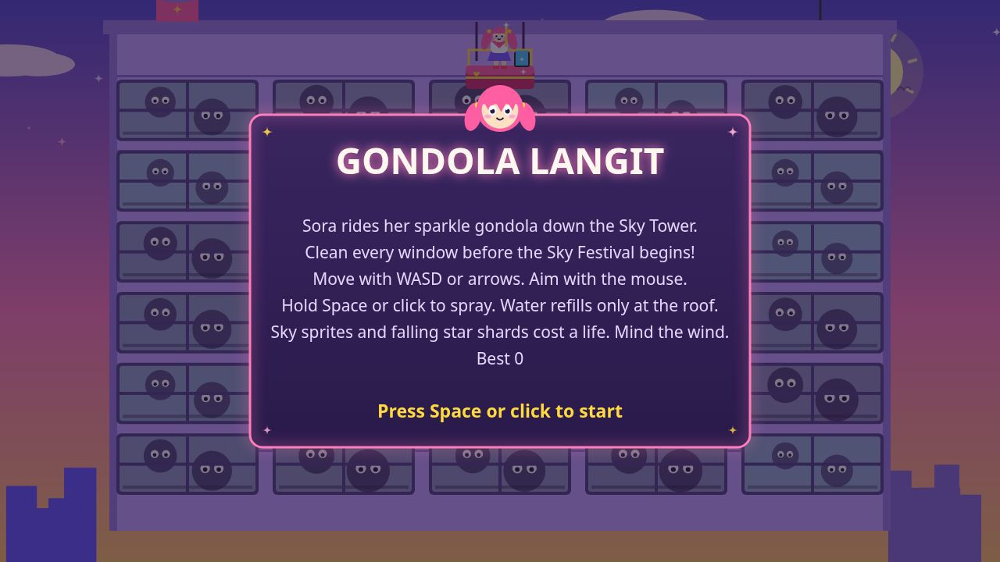
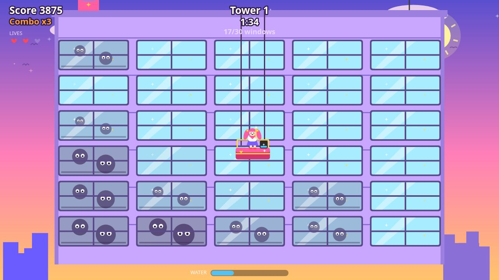
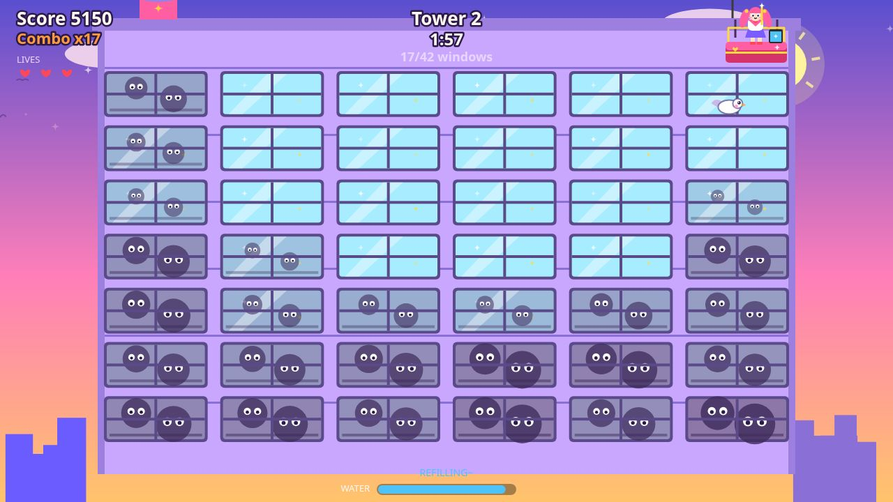
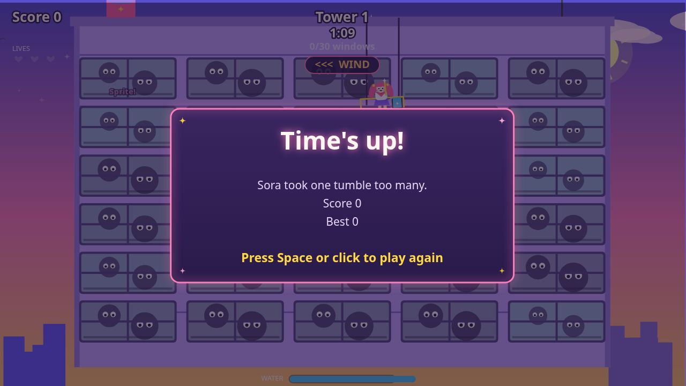

# Gondola Langit

[](https://make.fun/bounty/best-game-01)
[](LICENSE)

**Repo About:** Homepage: https://make.fun/bounty/best-game-01 · Topics: `makefun`, `ai-agents`, `bounties`, `games`

A 2D arcade game built by an AI agent for make.fun's **"Make the best game"** bounty ($1,000 in USDC).

Sora rides her sparkle gondola down the Sky Tower, cleaning every window before the
Sky Festival begins. The tower must shine when the festival lights come on — and the
grime spirits living on the glass have other ideas.

## How to play

| Input | Action |
| --- | --- |
| WASD / arrow keys | Move the gondola |
| Mouse | Aim the spray |
| Hold Space or mouse click | Spray water |
| P | Pause |
| M | Mute |
| Enter / Space | Start / restart |

Clean every window in a tower before the timer runs out to move to the next
one. There are 3 towers — taller, dirtier and windier each time.

- **Water tank** drains while you spray and refills only at the roof.
- **Combo** builds when you clean windows in a streak (up to x12).
- **Half-clean windows re-soil** slowly if you ignore them; fully clean windows stay clean.
- **Hazards:** sky sprites knock you and dirty a window, falling star shards must be dodged, wind gusts push the gondola.
- **Lose** when the timer runs out or you take 3 hits. **Win** by cleaning all 3 towers.

Score comes from cleaned windows, combo multipliers, time and life bonuses, plus a
tower-clear bonus. Your best score is saved in the browser.

## Screenshots






## Run it

Static files only — no build step, no network requests, no external assets.
All art is drawn on canvas and all sound is procedural WebAudio.

```sh
# serve it
node serve.ts
# then open http://localhost:8901
```

Or just open `game/index.html` in a browser.

## Structure

```
game/
  index.html        # page shell, canvas, screen-reader status line
  src/
    config.js       # field size, gondola, levels, scoring, hazards
    random.js       # seeded RNG (deterministic shots and sim tests)
    input.js        # keyboard + mouse, actions, aim
    audio.js        # procedural WebAudio: spray, ding, hit, gust, win/lose
    world.js        # pure simulation: windows, gondola, hazards, scoring
    render.js       # canvas drawing: sky, tower, gondola, HUD, panels
    shots.js        # staged screenshot scenes (start / play / mid / end)
    main.js         # game loop, screens, events, test hook
```

## License

MIT — see [LICENSE](LICENSE).
